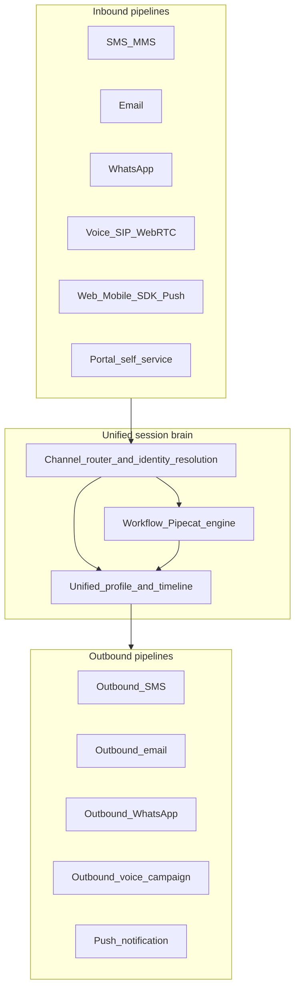
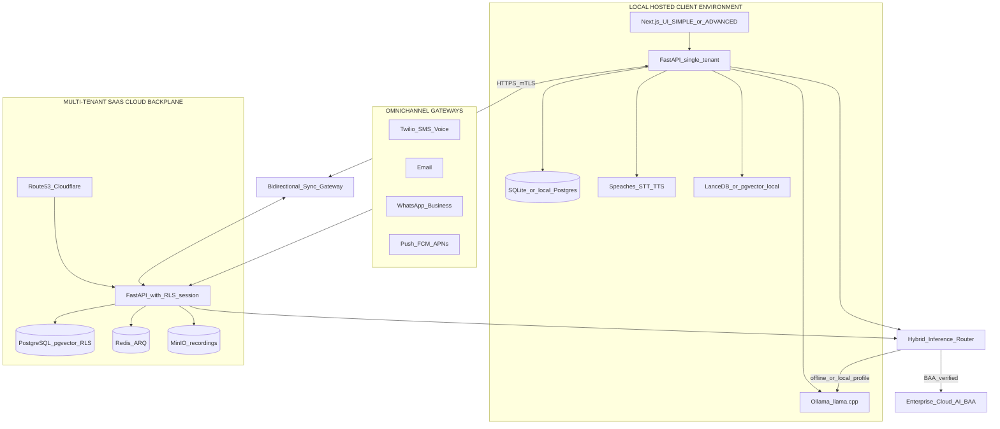

# Omnichannel CRM & ERP platform blueprint (ERP-01)

**Status:** Architecture & planning — **not** a delivery guarantee. Items are labeled **Shipped**, **Partial**, or **Gap** against this repo.

**Strategy anchor:** [READMEPLANNING.md](../READMEPLANNING.md) §9 · **Execution:** epic **ERP-01** in [READMEPLANTOEXECUTE.md](../READMEPLANTOEXECUTE.md)

**Positioning:** We **integrate natively** with Salesforce, HubSpot, NetSuite, Shopify, major EHRs, and ticketing stacks — and we **beat them in product delivery** for voice-first, omnichannel customer operations. Long-term growth is becoming the **CRM + ERP operators actually want**: unified profiles, hierarchical orgs, offline-capable local edge, and compliance-aware AI — on top of the voice agent platform we already ship.

---

## Table of contents

1. [Current foundation audit](#1-current-foundation-audit)
2. [Vertical omnichannel utility](#2-vertical-omnichannel-utility)
3. [Core architecture & PostgreSQL schemas](#3-core-architecture--postgresql-schemas)
4. [API routing logic](#4-api-routing-logic)
5. [Offline sync layer](#5-offline-sync-layer)
6. [Hybrid inference router & compliance](#6-hybrid-inference-router--compliance)
7. [System topology](#7-system-topology)
8. [Graduated UX/UI framework](#8-graduated-uxui-framework)
9. [Self-service execution engines](#9-self-service-execution-engines)
10. [Phased execution map](#10-phased-execution-map)

---

## 1. Current foundation audit

| Capability | Status | Ground truth in repo |
|------------|--------|------------------------|
| Voice + WebRTC runtime | **Shipped** | Pipecat pipeline, telephony, embed ([api/services/pipecat/run_pipeline.py](../api/services/pipecat/run_pipeline.py)) |
| HTTP tool integrations (CRM-shaped) | **Partial** | HTTP tools + Nango ([api/services/integrations/nango.py](../api/services/integrations/nango.py)); local CRM/OSS/ATS stubs ([api/routes/local_integrations.py](../api/routes/local_integrations.py)) |
| Local scheduling (calendar ERP slice) | **Shipped** | [api/routes/local_scheduling.py](../api/routes/local_scheduling.py), recipe [local-scheduling-all-in-one.md](recipes/local-scheduling-all-in-one.md) |
| Local payments / collections | **Shipped** | [api/routes/local_payments.py](../api/routes/local_payments.py) |
| Local EHR / healthcare records | **Shipped** | [api/routes/local_ehr.py](../api/routes/local_ehr.py) |
| Local inference (LLM/STT/TTS edge) | **Shipped** | Inference profiles, Ollama + Speaches, air-gap bundle ([api/services/configuration/local_inference.py](../api/services/configuration/local_inference.py)) |
| Capability modules (business motions) | **Shipped** | [capability-modules.json](capability-modules.json), [CAPABILITY_MODULES.md](CAPABILITY_MODULES.md) |
| Analytics + QM + call forensics | **Partial** | [api/routes/analytics.py](../api/routes/analytics.py); RLS on HTTP tool spans only |
| Omnichannel (SMS, email, WhatsApp, push) | **Gap** | Voice-centric; channel adapters are roadmap |
| Unified contact/profile CRM | **Gap** | `organization_id` tenancy; no `unified_profiles` yet |
| Infinite org hierarchy | **Gap** | Flat org model today |
| Offline-first sync / merge | **Gap** | Local JSON stores per org; no bidirectional cloud sync engine |
| Enterprise SSO + full-tenant RLS | **Gap** | Partial quotas/RBAC; analytics span RLS is first slice |
| BAA / HIPAA cloud inference gate | **Gap** | Inference profiles exist; compliance middleware is design |

**Local-all-in-one recipes (buyer-ready today):**

| Recipe | ERP/CRM slice |
|--------|----------------|
| [local-scheduling-all-in-one.md](recipes/local-scheduling-all-in-one.md) | Appointments, `.ics`, double-book protection |
| [local-payments-all-in-one.md](recipes/local-payments-all-in-one.md) | Collections, redirect, concierge enroll |
| [local-integrations-all-in-one.md](recipes/local-integrations-all-in-one.md) | CRM leads, OSS outage, ATS, banking, civic |
| [local-all-in-one-gtm-demo.md](recipes/local-all-in-one-gtm-demo.md) | End-to-end GTM wiring |

---

## 2. Vertical omnichannel utility

### 2.1 Channel architecture



| Channel | Sync mode | Identity key | Status |
|---------|-----------|--------------|--------|
| Voice (SIP/WebRTC) | Real-time | `phone_e164`, `webrtc_session_id` | **Shipped** |
| SMS/MMS | Async + optional real-time | `phone_e164` | **Gap** |
| Email | Async | `email` + `message_id` | **Gap** |
| WhatsApp | Async + session window | `whatsapp_id` | **Gap** |
| Web/Mobile push | Async | `device_token`, `user_id` | **Gap** |
| Portal self-service | Sync HTTP | `profile_id`, `session_cookie` | **Partial** (embed + HTTP tools) |

**Design rule:** one **`unified_profiles`** row per person; many **`omnichannel_interactions`** rows; **`channel_session_id`** links async threads to voice runs via `workflow_run_id`.

### 2.2 Vertical templates (out-of-the-box)

| Vertical | OOTB config pack | Key automations | Local demo path |
|----------|------------------|-----------------|-----------------|
| **Healthcare** | Secure patient portal hooks, telehealth intake, refill queue, HIPAA logging defaults | Prior auth → book → SMS confirm → EHR sync | [local EHR](../api/routes/local_ehr.py), `ehr_sync_complex` variant |
| **Supply chain / logistics** | Driver status, EDI translation, customs hold routing, warehouse event streams | Shipment exception → notify → reroute | **Gap** — extend `local_integrations` with `edi_document` + `shipment_event` types |
| **Retail / commerce** | Cart abandonment, B2B invoice, warranty, inventory allocation | WISMO → upsell → collections | **Shipped** retail pack + [local payments](recipes/local-payments-all-in-one.md) |

Vertical packs map to **`cloud_tenants.vertical_template`** and **`enterprise_nodes.metadata`** JSONB (see §3).

### 2.3 Native integration posture (beat them on delivery)

| External system | Integration mode | Our delivery advantage |
|-----------------|------------------|------------------------|
| Salesforce / HubSpot | Nango OAuth + HTTP tools + future bi-directional sync | Voice-native workflows + analytics proof in one UI |
| NetSuite / ERP | HTTP + EDI gateway | Pre-built capability modules + local ERP stubs for zero-setup demos |
| Shopify / OMS | Webhooks + HTTP tools | WISMO/collections graphs ship in catalog |
| Epic / Cerner | FHIR HTTP tools + local EHR | `ehr_sync_complex` happy-path in ≤8 turns |
| Zendesk / Intercom | Ticketing HTTP + omnichannel timeline | Single call detail with tool evidence + QM |

---

## 3. Core architecture & PostgreSQL schemas

**Tenancy model:**

- **Cloud SaaS:** shared PostgreSQL, **`tenant_id`** on all business tables, **RLS** via `app.current_tenant_id`.
- **Local edge:** single-tenant PostgreSQL or embedded SQLite; same schema minus RLS; migration script strips policies.
- **Bridge:** existing `organization_id` (integer) maps to `cloud_tenants.id` (UUID) during ERP-01 migration.

### 3.1 DDL — extensions and tenant engine

```sql
-- ERP-01-CORE-SCHEMA (target; not applied in repo yet)
CREATE EXTENSION IF NOT EXISTS "uuid-ossp";
CREATE EXTENSION IF NOT EXISTS "ltree";
CREATE EXTENSION IF NOT EXISTS "pgcrypto";
CREATE EXTENSION IF NOT EXISTS "vector";  -- pgvector for semantic search

-- 1. TENANT AND SUBSCRIPTION ENGINE
CREATE TABLE cloud_tenants (
    id UUID PRIMARY KEY DEFAULT gen_random_uuid(),
    legacy_organization_id INTEGER UNIQUE,  -- bridge from WorkflowDefinitionModel.org
    name VARCHAR(255) NOT NULL,
    sub_domain VARCHAR(63) UNIQUE NOT NULL,
    vertical_template VARCHAR(32) NOT NULL
        CHECK (vertical_template IN ('HEALTHCARE', 'SUPPLY_CHAIN', 'RETAIL', 'GENERAL')),
    deployment_mode VARCHAR(16) NOT NULL DEFAULT 'cloud'
        CHECK (deployment_mode IN ('cloud', 'local_edge', 'hybrid')),
    is_active BOOLEAN DEFAULT TRUE,
    created_at TIMESTAMPTZ DEFAULT CURRENT_TIMESTAMP,
    updated_at TIMESTAMPTZ DEFAULT CURRENT_TIMESTAMP
);

ALTER TABLE cloud_tenants ENABLE ROW LEVEL SECURITY;

CREATE POLICY cloud_tenants_self ON cloud_tenants
    FOR ALL
    USING (id = current_setting('app.current_tenant_id', true)::uuid);
```

### 3.2 Hierarchical nesting engine (materialized path + adjacency)

```sql
-- Infinite parent-child: holding → subsidiary → region → branch → department → account → sub-user
CREATE TABLE enterprise_nodes (
    id UUID PRIMARY KEY DEFAULT gen_random_uuid(),
    tenant_id UUID NOT NULL REFERENCES cloud_tenants(id) ON DELETE CASCADE,
    parent_id UUID REFERENCES enterprise_nodes(id) ON DELETE SET NULL,
    node_path LTREE NOT NULL,
    node_type VARCHAR(32) NOT NULL
        CHECK (node_type IN (
            'HOLDING', 'SUBSIDIARY', 'REGION', 'BRANCH',
            'DEPARTMENT', 'TEAM', 'ACCOUNT', 'SUB_PROFILE'
        )),
    name VARCHAR(255) NOT NULL,
    external_ref VARCHAR(128),  -- CRM account id, ERP cost center, etc.
    metadata JSONB NOT NULL DEFAULT '{}'::jsonb,
    sync_vector BIGINT NOT NULL DEFAULT 0,  -- Lamport-style counter per node
    created_at TIMESTAMPTZ DEFAULT CURRENT_TIMESTAMP,
    updated_at TIMESTAMPTZ DEFAULT CURRENT_TIMESTAMP,
    deleted_at TIMESTAMPTZ,
    CONSTRAINT fk_enterprise_nodes_tenant FOREIGN KEY (tenant_id) REFERENCES cloud_tenants(id)
);

CREATE INDEX idx_enterprise_nodes_path ON enterprise_nodes USING gist (node_path);
CREATE INDEX idx_enterprise_nodes_tenant ON enterprise_nodes (tenant_id);
CREATE INDEX idx_enterprise_nodes_parent ON enterprise_nodes (parent_id) WHERE deleted_at IS NULL;

ALTER TABLE enterprise_nodes ENABLE ROW LEVEL SECURITY;

CREATE POLICY enterprise_nodes_tenant_isolation ON enterprise_nodes
    FOR ALL
    USING (tenant_id = current_setting('app.current_tenant_id', true)::uuid);

-- Recursive CTE: descendants of a node
-- SELECT en.* FROM enterprise_nodes en
-- WHERE en.node_path <@ (SELECT node_path FROM enterprise_nodes WHERE id = :root_id)
--   AND en.tenant_id = :tenant_id AND en.deleted_at IS NULL;
```

**Path assignment on insert:** `node_path = parent.node_path || text2ltree(replace(child_id::text, '-', '_'))`.

### 3.3 Unified profiles & omnichannel timeline

```sql
CREATE TABLE unified_profiles (
    id UUID PRIMARY KEY DEFAULT gen_random_uuid(),
    tenant_id UUID NOT NULL REFERENCES cloud_tenants(id) ON DELETE CASCADE,
    current_node_id UUID NOT NULL REFERENCES enterprise_nodes(id),
    profile_type VARCHAR(32) NOT NULL
        CHECK (profile_type IN ('B2B_CLIENT', 'B2C_CUSTOMER', 'INTERNAL_STAFF')),
    first_name VARCHAR(128),
    last_name VARCHAR(128),
    email VARCHAR(255),
    phone_e164 VARCHAR(32),
    whatsapp_id VARCHAR(64),
    external_crm_id VARCHAR(128),
    preferences JSONB NOT NULL DEFAULT '{}'::jsonb,
    sync_vector BIGINT NOT NULL DEFAULT 0,
    created_at TIMESTAMPTZ DEFAULT CURRENT_TIMESTAMP,
    updated_at TIMESTAMPTZ DEFAULT CURRENT_TIMESTAMP,
    UNIQUE (tenant_id, email) WHERE email IS NOT NULL,
    UNIQUE (tenant_id, phone_e164) WHERE phone_e164 IS NOT NULL
);

CREATE TABLE omnichannel_interactions (
    id UUID PRIMARY KEY DEFAULT gen_random_uuid(),
    tenant_id UUID NOT NULL REFERENCES cloud_tenants(id) ON DELETE CASCADE,
    profile_id UUID NOT NULL REFERENCES unified_profiles(id) ON DELETE CASCADE,
    workflow_run_id INTEGER,  -- bridge to WorkflowRunModel when voice
    direction VARCHAR(16) NOT NULL CHECK (direction IN ('INBOUND', 'OUTBOUND')),
    channel VARCHAR(32) NOT NULL
        CHECK (channel IN ('SMS', 'EMAIL', 'WHATSAPP', 'VOICE', 'PORTAL_SELF_SERVICE', 'PUSH')),
    channel_session_id UUID,
    payload JSONB NOT NULL,
    compliance_scrubbed BOOLEAN DEFAULT FALSE,
    payload_hash CHAR(64),  -- SHA-256 hex for audit
    created_at TIMESTAMPTZ DEFAULT CURRENT_TIMESTAMP
);

CREATE INDEX idx_omni_profile_created ON omnichannel_interactions (profile_id, created_at DESC);
CREATE INDEX idx_omni_tenant_channel ON omnichannel_interactions (tenant_id, channel, created_at DESC);

ALTER TABLE unified_profiles ENABLE ROW LEVEL SECURITY;
ALTER TABLE omnichannel_interactions ENABLE ROW LEVEL SECURITY;

CREATE POLICY unified_profiles_tenant ON unified_profiles
    FOR ALL USING (tenant_id = current_setting('app.current_tenant_id', true)::uuid);

CREATE POLICY omnichannel_tenant ON omnichannel_interactions
    FOR ALL USING (tenant_id = current_setting('app.current_tenant_id', true)::uuid);
```

### 3.4 ERP operational objects (inventory, orders, invoices)

```sql
CREATE TABLE erp_orders (
    id UUID PRIMARY KEY DEFAULT gen_random_uuid(),
    tenant_id UUID NOT NULL REFERENCES cloud_tenants(id) ON DELETE CASCADE,
    profile_id UUID REFERENCES unified_profiles(id),
    node_id UUID REFERENCES enterprise_nodes(id),
    order_number VARCHAR(64) NOT NULL,
    status VARCHAR(32) NOT NULL,
    line_items JSONB NOT NULL DEFAULT '[]'::jsonb,
    total_cents BIGINT NOT NULL DEFAULT 0,
    currency CHAR(3) NOT NULL DEFAULT 'USD',
    external_oms_id VARCHAR(128),
    sync_vector BIGINT NOT NULL DEFAULT 0,
    created_at TIMESTAMPTZ DEFAULT CURRENT_TIMESTAMP,
    updated_at TIMESTAMPTZ DEFAULT CURRENT_TIMESTAMP,
    UNIQUE (tenant_id, order_number)
);

CREATE TABLE erp_inventory_events (
    id UUID PRIMARY KEY DEFAULT gen_random_uuid(),
    tenant_id UUID NOT NULL REFERENCES cloud_tenants(id) ON DELETE CASCADE,
    node_id UUID NOT NULL REFERENCES enterprise_nodes(id),
    sku VARCHAR(64) NOT NULL,
    delta_qty INTEGER NOT NULL,
    reason VARCHAR(64) NOT NULL,
    source_interaction_id UUID REFERENCES omnichannel_interactions(id),
    created_at TIMESTAMPTZ DEFAULT CURRENT_TIMESTAMP
);

ALTER TABLE erp_orders ENABLE ROW LEVEL SECURITY;
ALTER TABLE erp_inventory_events ENABLE ROW LEVEL SECURITY;

CREATE POLICY erp_orders_tenant ON erp_orders
    FOR ALL USING (tenant_id = current_setting('app.current_tenant_id', true)::uuid);

CREATE POLICY erp_inventory_tenant ON erp_inventory_events
    FOR ALL USING (tenant_id = current_setting('app.current_tenant_id', true)::uuid);
```

### 3.5 Compliance audit ledger (immutable inference + channel egress)

```sql
CREATE TABLE compliance_audit_ledger (
    id UUID PRIMARY KEY DEFAULT gen_random_uuid(),
    tenant_id UUID NOT NULL,
    event_type VARCHAR(64) NOT NULL,  -- CLOUD_INFERENCE_BAA, CHANNEL_EGRESS, PII_SCRUB
    routing_path VARCHAR(128) NOT NULL,
    model_identifier VARCHAR(255),
    payload_sha256 CHAR(64) NOT NULL,
    metadata JSONB NOT NULL DEFAULT '{}'::jsonb,
    recorded_at TIMESTAMPTZ NOT NULL DEFAULT CURRENT_TIMESTAMP,
    ledger_hmac BYTEA NOT NULL  -- HMAC-SHA256(chain_key, prev || row)
);

-- Append-only: REVOKE UPDATE, DELETE from application role
CREATE INDEX idx_audit_tenant_time ON compliance_audit_ledger (tenant_id, recorded_at DESC);
```

### 3.6 Local edge migration script (single-tenant)

```sql
-- scripts/erp_migrate_local_edge.sql (concept)
-- 1. DROP POLICY IF EXISTS on all ERP tables
-- 2. ALTER TABLE ... DISABLE ROW LEVEL SECURITY
-- 3. INSERT single cloud_tenants row with deployment_mode = 'local_edge'
-- 4. Optional: ATTACH sqlite via foreign data wrapper OR use bundled SQLite schema mirror
```

**Maps to today:** `run/local_scheduling/`, `run/local_integrations/`, `run/local_payments/` JSON files become **`erp_*`** tables under one `tenant_id` on upgrade.

---

## 4. API routing logic

**Mount prefix:** `/api/v1/erp` (new router; does not replace existing workflow routes).

| Method | Path | Handler responsibility | Auth context |
|--------|------|------------------------|--------------|
| `GET` | `/erp/nodes` | List roots or `?parent_id=` children | `SET app.current_tenant_id` |
| `GET` | `/erp/nodes/{id}/descendants` | Recursive CTE tree | tenant RLS |
| `POST` | `/erp/nodes` | Create child; compute `node_path` | tenant + node write RBAC |
| `GET` | `/erp/profiles` | Search by email/phone/external_crm_id | tenant RLS |
| `POST` | `/erp/profiles` | Upsert profile; emit sync vector | tenant RLS |
| `GET` | `/erp/profiles/{id}/timeline` | Paginated `omnichannel_interactions` | tenant + profile scope |
| `POST` | `/erp/interactions` | Ingest channel payload; link `workflow_run_id` | channel webhook HMAC |
| `GET` | `/erp/orders` | B2B/B2C order list with node filter | tenant RLS |
| `POST` | `/erp/orders` | Create from workflow HTTP tool or portal | idempotency-key header |
| `POST` | `/erp/sync/push` | Edge → cloud batch (see §5) | mTLS or sync JWT |
| `POST` | `/erp/sync/pull` | Cloud → edge delta since vector | sync JWT |

**FastAPI session pattern (extends analytics RLS):**

```python
# api/db/erp_session.py (target)
async def erp_db_session(tenant_id: UUID, session: AsyncSession):
    await session.execute(
        text("SELECT set_config('app.current_tenant_id', :tid, true)"),
        {"tid": str(tenant_id)},
    )
    yield session
```

**Bridge from voice runs:** Pipecat post-call hook writes `omnichannel_interactions` with `channel='VOICE'` and `workflow_run_id` — extends [call_intel.py](../api/services/analytics/call_intel.py).

---

## 5. Offline sync layer

### 5.1 ID and timestamp rules

| Field | Format | Rule |
|-------|--------|------|
| Primary keys | **UUIDv7** (time-ordered) | Generated client-side on edge when offline |
| `sync_vector` | **Monotonic BIGINT** per table row | Increment on every local mutation |
| `updated_at` | **RFC 3339 UTC** with microsecond precision | Server authoritative on merge tie-break |
| Tombstones | `deleted_at` + `sync_vector` | Replicate deletes; never hard-delete on edge until ack |

### 5.2 Conflict resolution (last-writer-wins with guards)

```text
On push(batch):
  For each record R with (id, sync_vector, updated_at, payload):
    If server has no R → INSERT
    If server.sync_vector < R.sync_vector → UPDATE (edge wins)
    If server.sync_vector == R.sync_vector → SKIP (idempotent)
    If server.sync_vector > R.sync_vector → RETURN conflict entry;
      client merges via field-level CRDT for JSONB metadata only
    For erp_orders / financial rows → REJECT conflict; require manual operator merge (ADVANCED UI)
```

### 5.3 Sync gateway component

```mermaid
sequenceDiagram
  participant Edge as Local_edge_SQLite
  participant GW as Sync_gateway
  participant Cloud as Cloud_Postgres_RLS

  Edge->>GW: POST /erp/sync/push (batch, device_id)
  GW->>Cloud: BEGIN; set tenant; apply rows
  Cloud-->>GW: conflicts + new server vectors
  GW-->>Edge: 200 + pull cursor
  Edge->>GW: POST /erp/sync/pull (since_cursor)
  GW->>Cloud: SELECT changes sync_vector > cursor
  Cloud-->>GW: delta batch
  GW-->>Edge: 200 + merged state
```

**Status:** **Gap** — design only. Existing local stores ([local_scheduling/store.py](../api/services/local_scheduling/store.py)) are the migration source.

---

## 6. Hybrid inference router & compliance

Extends **Shipped** [inference_profiles.py](../api/services/configuration/inference_profiles.py) with a **compliance middleware** layer for regulated cloud inference.

### 6.1 Router decision tree

```text
request arrives
├─ ENFORCE_LOCAL_INFERENCE_ONLY=true → local Ollama/Speaches
├─ workflow.inference_profile_id = local_edge_lean → local
├─ requires_baa=true
│   ├─ endpoint not in signed BAA registry → HALT 403
│   ├─ scrub PII/metadata → cloud BAA endpoint
│   └─ append compliance_audit_ledger row
└─ standard cloud profile → cloud with optional scrub
```

### 6.2 Production middleware (Python)

```python
# api/services/erp/hybrid_inference_router.py (target — extends local_inference.py)
from __future__ import annotations

import hashlib
import json
import os
import time
from dataclasses import dataclass
from typing import Any

import httpx

from api.services.configuration.inference_profiles import (
    get_inference_profile,
    merge_profile_into_user_configuration,
)


@dataclass
class EnterpriseAIRequest:
    tenant_id: str
    payload: dict[str, Any]
    profile_id: str = "local_edge_lean"
    requires_baa: bool = False


class BAARegistry:
    """Pre-signed Business Associate Agreement endpoint allowlist."""

    @staticmethod
    def is_verified(endpoint: str) -> bool:
        allowed = os.getenv("BAA_VERIFIED_ENDPOINTS", "").split(",")
        return endpoint.strip("/") in {e.strip("/") for e in allowed if e}


class SecurityComplianceAuditLogger:
    @staticmethod
    async def write(entry: dict[str, Any]) -> None:
        # Route to compliance_audit_ledger + WORM object storage
        ...

class HybridInferenceRouter:
    def __init__(self, local_base: str, cloud_baa_base: str):
        self.local_base = local_base.rstrip("/")
        self.cloud_baa_base = cloud_baa_base.rstrip("/")

    async def route_and_execute(
        self, request: EnterpriseAIRequest, *, network_available: bool
    ) -> dict[str, Any]:
        profile = get_inference_profile(request.profile_id)

        if not network_available or os.getenv("ENFORCE_LOCAL_INFERENCE_ONLY") == "TRUE":
            return await self._execute_local(request.payload, profile)

        if profile.get("tier") == "local":
            return await self._execute_local(request.payload, profile)

        if request.requires_baa:
            return await self._execute_secure_cloud_baa(request)

        return await self._execute_standard_cloud(request.payload, profile)

    async def _execute_local(self, payload: dict[str, Any], profile: dict) -> dict[str, Any]:
        async with httpx.AsyncClient(timeout=120.0) as client:
            # Ollama OpenAI-compatible /v1/chat/completions
            resp = await client.post(f"{self.local_base}/v1/chat/completions", json=payload)
            resp.raise_for_status()
            return {"status": "success", "engine": "local", "result": resp.json()}

    async def _execute_secure_cloud_baa(self, request: EnterpriseAIRequest) -> dict[str, Any]:
        if not BAARegistry.is_verified(self.cloud_baa_base):
            raise PermissionError("Cloud endpoint not in signed BAA registry")

        start = time.time()
        scrubbed = self._pii_scrubber(request.payload)
        headers = {
            "X-Enterprise-BAA-Compliance": "true",
            "X-Zero-Data-Retention": "true",
            "Authorization": f"Bearer {os.getenv('SECURE_CLOUD_AI_KEY', '')}",
        }
        payload_hash = hashlib.sha256(json.dumps(scrubbed, sort_keys=True).encode()).hexdigest()

        async with httpx.AsyncClient(timeout=120.0) as client:
            resp = await client.post(
                f"{self.cloud_baa_base}/v1/chat/completions",
                json=scrubbed,
                headers=headers,
            )
            resp.raise_for_status()
            body = resp.json()

        await SecurityComplianceAuditLogger.write({
            "tenant_id": request.tenant_id,
            "event_type": "CLOUD_INFERENCE_BAA",
            "routing_path": "SECURE_CLOUD_BAA_GATEWAY",
            "model_identifier": scrubbed.get("model"),
            "payload_sha256": payload_hash,
            "duration_ms": (time.time() - start) * 1000,
            "compliance_verified": True,
        })
        return {
            "status": "success",
            "engine": "cloud_enterprise_secure",
            "result": body,
            "compliance_notice": (
                "Regulated environment: secure cloud inference — verified BAA pipeline"
            ),
        }

    async def _execute_standard_cloud(self, payload: dict, profile: dict) -> dict[str, Any]:
        ...

    @staticmethod
    def _pii_scrubber(payload: dict[str, Any]) -> dict[str, Any]:
        # Deep walk: strip keys matching PHI/PII patterns; keep task text only
        ...
```

**Wire point:** [run_pipeline.py](../api/services/pipecat/run_pipeline.py) resolves `inference_profile_id` from workflow config before LLM processor construction.

---

## 7. System topology



**Docker Compose fast-track (ERP-01-INFRA slice):** extend [docker-compose-local.yaml](../docker-compose-local.yaml) with `local-inference` profile (already **Shipped**), add `pgvector` service and optional `sync-gateway` sidecar — see package **ERP-01-INFRA** in READMEPLANTOEXECUTE.

---

## 8. Graduated UX/UI framework

Builds on **Shipped** WE-01 hyper-density ([READMEPLANTOEXECUTE.md](../READMEPLANTOEXECUTE.md) § WE-01-HYPER-DENSITY) and DX-01 onboarding.

### 8.1 Configuration model

```typescript
// ui/src/lib/erp/workspaceDensity.ts (target)
export type ViewMode = "SIMPLE" | "ADVANCED";
export type VerticalTemplate =
  | "HEALTHCARE"
  | "SUPPLY_CHAIN"
  | "RETAIL"
  | "GENERAL";

export interface UIConfiguration {
  viewMode: ViewMode;
  verticalTemplate: VerticalTemplate;
  isOnboardingPhase: boolean;
  complianceBannerActive: boolean;
}

export interface WorkspaceLayoutSlots {
  commandBar: React.ReactNode;
  rollupCards: React.ReactNode;
  contextTips: React.ReactNode; // hover/focus/anomaly only
  hierarchyTree?: React.ReactNode; // ADVANCED only
  telemetryTerminal?: React.ReactNode; // ADVANCED only
  syncStatusStrip?: React.ReactNode; // ADVANCED only
}
```

### 8.2 Layout behavior

| Surface | SIMPLE mode | ADVANCED mode |
|---------|-------------|---------------|
| **Overview** | 3–5 rollup cards, single primary CTA | Bento grid + sparklines + sync lag badge |
| **CRM timeline** | Priority queue, one-click resolve | Full omnichannel matrix + raw JSON drawer |
| **Org hierarchy** | Hidden; search-only | Left rail recursive tree ([enterprise_nodes](#32-hierarchical-nesting-engine-materialized-path--adjacency)) |
| **Inference** | Profile quick-switch (**Shipped**) | Per-stage latency + audit log viewer |
| **Onboarding** | Card walkthrough + template injector | OAuth cluster map + vector DB path + stress test |

### 8.3 Context-aware micro-interactions

- **Progressive disclosure:** insights render on `hover`, `focus-within`, or `data-anomaly=true` — never by default.
- **Compliance banner:** shown when `complianceBannerActive` (BAA cloud path); matches inference router notice string.
- **Toggle:** header control persists `viewMode` to `localStorage` + org preference API.

**Existing primitives to reuse:** [DismissibleHintBanner.tsx](../ui/src/components/onboarding/DismissibleHintBanner.tsx), [InferenceProfileQuickSwitch.tsx](../ui/src/components/InferenceProfileQuickSwitch.tsx), [AppCommandPalette.tsx](../ui/src/components/layout/AppCommandPalette.tsx), `ovo-*` CSS tokens.

### 8.4 Dual-track onboarding

| Track | Steps | Sandbox |
|-------|-------|---------|
| **Simple** | Pick vertical → install capability modules → wire local calendar → first Web call | Zero manual setup via [bootstrap_fresh_dev.sh](../scripts/bootstrap_fresh_dev.sh) |
| **Advanced** | Multi-region node map → OIDC → `LOCAL_INFERENCE_BUNDLE` import → sync stress profile | [local-all-in-one-gtm-demo.sh](../scripts/gtm-local-all-in-one-demo.sh) |

---

## 9. Self-service execution engines

### 9.1 Internal employees (access provisioning)

```text
Policy: role_template × enterprise_node_path
Engine: evaluate JWT groups → auto-provision unified_profiles (INTERNAL_STAFF)
Audit: every grant/revoke → compliance_audit_ledger
```

**Status:** **Gap** — design. Partial: Stack Auth team permissions ([test_stack_auth_team_permissions_url_unit.py](../api/tests/test_stack_auth_team_permissions_url_unit.py)).

### 9.2 B2B clients (shared sub-tenant portal)

```text
B2B account = enterprise_node (type ACCOUNT) + child SUB_PROFILE rows
Portal dashboard: orders, invoices, open interactions — scoped by node_path <@ account_path
```

### 9.3 B2C users (conversational ticket clearing)

```text
Inbound WhatsApp/SMS → resolve profile → attach to open interaction thread
Workflow FAQ/agent node → close interaction when outcome=resolved
ERP: optional erp_orders status update via HTTP tool
```

**Example mapping (WhatsApp → supply chain):**

```text
1. Webhook POST /api/v1/erp/interactions (channel=WHATSAPP)
2. Router resolves profile by whatsapp_id
3. If message contains tracking # → HTTP tool GET shipment → erp_inventory_events
4. Outbound template reply + timeline row
5. Analytics: capability_module_id=operations_status on workflow metadata
```

---

## 10. Phased execution map

| Phase | Package ID | Deliverable | Depends on |
|-------|------------|-------------|------------|
| **0** | (today) | Local scheduling, payments, integrations, EHR, inference profiles | **Shipped** |
| **1** | ERP-01-CORE-SCHEMA | Alembic migration + RLS session helper + `organization_id` bridge | — |
| **2** | ERP-01-PROFILES | `unified_profiles` CRUD + voice run timeline bridge | 1 |
| **3** | ERP-01-HIERARCHY | `enterprise_nodes` + recursive API + SIMPLE tree UI | 1 |
| **4** | ERP-01-OMNI-VOICE | Voice channel writes to `omnichannel_interactions` | 2 |
| **5** | ERP-01-OMNI-ASYNC | SMS/email/WhatsApp adapters + webhook security | 4 |
| **6** | ERP-01-SYNC | Push/pull gateway + conflict policy | 1–3 |
| **7** | ERP-01-INFERENCE-COMPLY | BAA registry + audit ledger + router middleware | WE-01 inference |
| **8** | ERP-01-UX-DENSITY | SIMPLE/ADVANCED toggle + compliance banner | WE-01-HYPER-DENSITY |
| **9** | ERP-01-ERP-OBJECTS | Orders, inventory events, B2B invoice flows | 2, 3 |
| **10** | ERP-01-VERTICAL-SC | Supply chain EDI + healthcare portal packs | 5, 9 |

**WIP rule:** one **InProgress** ERP package at a time (same as [READMEPLANTOEXECUTE.md](../READMEPLANTOEXECUTE.md) operating model).

---

## Related docs

- Local capabilities recipes: [recipes/](recipes/)
- Capability motions: [CAPABILITY_MODULES.md](CAPABILITY_MODULES.md)
- Inference profiles: [inference-providers.mdx](../docs/configurations/inference-providers.mdx)
- Analytics + redaction: [ANALYTICS_REDACTION_MATRIX.md](ANALYTICS_REDACTION_MATRIX.md)
