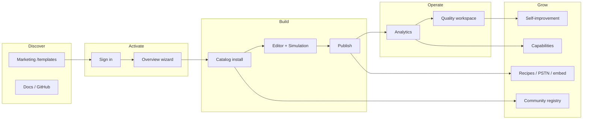

# Master CXD — Marketing → Onboarding → Daily Use → Growth

**Status:** Draft for review  
**Date:** 2026-07-03  
**Aligns with:** [READMEEXPERIENCE.md](../../../READMEEXPERIENCE.md) (Tier 1/2/3), [READMEPLANNING.md](../../../READMEPLANNING.md) §6 marketplace, MK-01 / DX-01 / WE-01 in [READMEPLANTOEXECUTE.md](../../../READMEPLANTOEXECUTE.md)  
**Execution ID:** `DX-01-CXD-MASTER`

---

## 0. North star

**One sentence:** A new operator hears a working voice agent on their template in under 15 minutes—with proof in analytics—without opening JSON; builders graduate to recipes and API; engineers graduate to ADK/MCP.

**Primary success metrics (product)**

| Metric | Definition | Target (v1) |
|--------|------------|-------------|
| **Time-to-first-audio** | Sign-up → first completed Web test run | &lt; 15 min (Tier 1) |
| **Wizard completion** | `prove_value` step marked done | ≥ 40% of new OSS orgs |
| **Template attach rate** | First workflow has `mk01.catalog_slug` | ≥ 60% of new orgs |
| **Proof loop** | Install → call with trace in analytics | ≥ 30% within 7 days |
| **Tier graduation** | Org opens `/recipes` or Developers within 30 days | Track; no target yet |

**Design principles**

1. **One obvious next step** — every surface ends with a single primary CTA.
2. **Proof before PSTN** — Web test and analytics proof precede telephony spend.
3. **Local-first wedge** — no API keys path is the default story for OSS/SMB.
4. **Tier honesty** — label surfaces Tier 1 / Builder / ADK so users self-segment.
5. **Recover, don’t abandon** — every drop-off has a visible rescue path.

---

## 1. Personas & jobs-to-be-done

### Experience tiers (canonical)

| Tier | Persona | Job | Primary routes |
|------|---------|-----|----------------|
| **1 — Operator** | Owner-operator, IC, non-dev founder | “Hear my business on a call today” | `/overview`, `/workflow/catalog`, editor Simulation |
| **2 — Builder** | Agency, technical founder, glue engineer | “Wire my stack with minimal code” | `/recipes`, Settings local stubs, OpenAPI |
| **3 — ADK** | Product engineer, IDE agent | “Automate via REST/MCP/fork” | Developers, MCP, `READMEADK.md` |

### Industry buyer personas (catalog)

14 vertical packs + 3 onboarding shortcuts (salon, handyman, coach). Catalog is **industry-aware marketing**; onboarding uses **field-services SMB wedge** only.

### Role variants

| Role | Landing today | CXD target |
|------|---------------|------------|
| OSS new user, 0 workflows | `/workflow/create` | **`/overview`** (wizard) |
| OSS returning user | `/workflow` | `/workflow` or last editor |
| Stack admin | `/workflow` | `/overview` if onboarding incomplete |
| Stack member | `/usage` | Usage + read-only analytics links |
| Superuser | `/superadmin` | Unchanged |

---

## 2. Lifecycle phases (master journey)

---

## 3. Phase A — Marketing & discovery

### Surfaces

| Surface | Audience | Primary CTA | Secondary CTA |
|---------|----------|-------------|---------------|
| **`/templates`** (public) | SEO, cold traffic | **Sign in to install** | Browse community library tab |
| **docs / GitHub** | Developers, evaluators | Clone / run bootstrap | Star on GitHub |
| **GTM deck PNGs** | Sales | Book demo | — |

### CXD refinements

**A1 — Unified catalog story**  
- Public and authenticated catalogs share **Templates** + **Community library** tabs (shipped).  
- Public page adds hero: *“14 industry templates · local voice stack · no API keys”* with tier badges on cards (shipped on auth catalog; **mirror on `/templates`**).

**A2 — Try-before-sign-in (lite)**  
- **Voice preview audio** on public cards (`GET …/voice-preview/audio`) — no auth.  
- Optional: **read-only prompt excerpt** from community registry `prompt_pack` listing.  
- CTA hierarchy: **Listen** → **Sign in to install** → **See community assets**.

**A3 — Marketing CTA copy (registry)**

| Moment | Headline | Primary button | Microcopy |
|--------|----------|----------------|-----------|
| Hero | Voice agents that work on your machine | Browse templates | Free tier · MIT · local LLM/STT/TTS |
| Pack card | {display_name} | Sign in to install | {tier badge} · {industry} |
| Community tab | Tools, prompts, recipes | Explore library | Shareable registry · paid tiers coming |
| Post-sign-in email (future) | Your salon template is one click away | Open Home | — |

**A4 — URL strategy**  
- Canonical browse: `/templates` (public), `/workflow/catalog` (authenticated).  
- Cross-link both; `rel=canonical` on public for SEO.

### Drop-off recovery (marketing)

| Drop-off | Signal | Recovery |
|----------|--------|----------|
| Bounce on `/templates` | &lt; 30s session | Auto-play voice preview on first card hover/focus |
| Sign-in abandon | OAuth cancel | Return URL preserves `?capability=` deep link |
| “API unreachable” | loadError on catalog | Static fallback from committed `vertical-packs.json` + registry JSON |

---

## 4. Phase B — Auth & first landing

### Current gap (critical)

Post-login **`/` routes to `/workflow/create`**, bypassing `/overview` and **GettingStartedWizard**.

### CXD decision (recommended)

**Route new OSS orgs (0 workflows) to `/overview?onboarding=1`** instead of `/workflow/create`.

| Condition | Redirect |
|-----------|----------|
| `active_workflows === 0` && onboarding not completed | `/overview` |
| `active_workflows === 0` && onboarding completed | `/workflow/catalog` |
| `active_workflows > 0` | `/workflow` |
| Deep link `?next=/workflow/123` | Honor `next` |

**Stack admin:** same as OSS if onboarding incomplete (server-side flag later; until then localStorage + “Resume setup” on overview).

### First-screen hierarchy on `/overview`

1. **GettingStartedWizard** (if not dismissed/completed) — dominant  
2. Operator path hint (dismissible)  
3. Bento: Agents · Templates · Analytics · Quality · Recipes  
4. GitHub star (OSS only)

---

## 5. Phase C — Onboarding system

### Canonical path: 4-step wizard

| Step | User sees | Success criteria | Primary CTA | Skip behavior |
|------|-----------|------------------|-------------|---------------|
| 1 Local models | `LocalInferenceSetupPanel` | `local_edge_lean` applied OR skipped | **Use local models** | “Cloud keys later” — show warning if no keys |
| 2 Install template | 3 SMB packs | Workflow created with `mk01` metadata | **Install template** | — |
| 3 Web test | Run in browser | `runId` stored | **Start Web test** | Block step 4 until run exists |
| 4 Prove value | Analytics | User opens filtered calls | **Open call analytics** | **Finish** marks complete |

### Consolidate competing paths

| Path today | Disposition |
|------------|-------------|
| `/workflow/create` AI agent | **Secondary** — link from wizard “Or describe your own agent” |
| `WorkflowGetStartedPanel` | **Align copy** with wizard steps; hide if wizard active |
| Catalog quick-start hint | **Keep** — reinforces step 2 |

### Dismissible hints — policy upgrade

| Current | Target |
|---------|--------|
| Dismiss = forever (localStorage) | Dismiss = hide 7 days; **“Show tips again”** in Settings → Help |
| Siloed per page | **Progress rail** in sidebar: “Setup 2/4” linking to `/overview` |

### Persistence roadmap

| v1 (now) | v2 |
|----------|-----|
| `ovo_getting_started_v1` localStorage | Org-level `onboarding_state` in user configuration |
| Per-browser | Cross-device resume |

---

## 6. Phase D — Daily use (build)

### Information architecture

**Sidebar BUILD** — unchanged core.  
**Add to OBSERVE:** **Quality & improvement** → `/analytics/quality` (today: orphan except subnav).

### Editor happy path (outcome checklist)

Ordered proof for Tier 1:

1. **Flow** — start → agent → end  
2. **HTTP tools** — wired (or local stub linked from Settings)  
3. **Validates** — publish gate green  
4. **Published** — embed/PSTN optional  

**CTA registry (editor)**

| Zone | Primary | When |
|------|---------|------|
| Header | **Start Web test** | Draft exists |
| Header | **Publish** | Validation pass |
| Right rail Simulation | **Start Web test** | Same as header |
| Right rail | **LoopTalk** | After first Web test |
| Header links | Analytics · Capabilities marketplace | Catalog lineage installs |

### Plain-language validation (shipped)

Keep **friendly titles** + fix hints; add **“Fix next”** button jumping to offending node.

### Tier signaling in editor

- Catalog-installed workflows: badge **Tier 1 template · {slug}** in header metadata.  
- “Graduate to Builder” chip → `/recipes` when user adds HTTP tool or telephony.

---

## 7. Phase E — Daily use (operate)

### Analytics loop (proof vocabulary)

Teach once, reuse everywhere:

- **`catalog_slug`** — which template  
- **`catalog_variant_id`** — simple vs booking_complex  
- **`capability_module_ids`** — buyer motion filter  

**Primary operate CTAs**

| Surface | CTA | Destination |
|---------|-----|-------------|
| Analytics overview | View calls for {capability} | `/analytics/calls?...` |
| Call list | Open call | `/analytics/calls/{id}` |
| Call detail | **Run AI review** | In-panel |
| Call detail | **Open quality queue** | `/analytics/quality` |
| Quality workspace | Approve improvement | In-place |
| Review inbox tab | Assign follow-up | In-place |

### Quality workspace positioning

**Rename in nav:** “Quality & improvement” (shipped in subnav).  
**Sidebar:** add under OBSERVE between Analytics and Review inbox — or merge Review inbox into Quality only (reduce duplication).

### Omnichannel timeline

Empty state CTA: **Send demo SMS** → Settings `#local-messaging` (deep link), not prose-only.

---

## 8. Phase F — Growth & graduation

### Growth motions (ordered by maturity)

| Motion | Entry | CTA | Tier |
|--------|-------|-----|------|
| **Capability modules** | Catalog filters | Install best match | 1 |
| **Community registry** | Catalog tab | Export / browse | 1–2 |
| **Self-improvement** | Quality policy `suggest` | Run AI review on calls | 1–2 |
| **Recipes** | Overview bento | Open recipe | 2 |
| **Inference profiles** | Wizard + Models | Quick switch | 1–2 |
| **MCP / ADK** | Settings Developers | Read READMEADK | 3 |
| **Monetization** (future) | Registry tier badges | Checkout | 1+ |

### Tier graduation triggers (in-product)

| User action | Nudge |
|-------------|-------|
| Adds HTTP tool | “Wire with a recipe” → local-scheduling recipe |
| Publishes + 10+ calls | “Turn on improvement suggestions” → Quality policy |
| Opens Settings telephony | Builder checklist embed + PSTN |
| Clones workflow JSON | “ADK path” → Developers |

### Self-improvement CXD

- Default policy: **`suggest`** (human approval).  
- Post–AI-review toast: “Recommendation added to queue” + link.  
- Weekly email (future): N proposals pending.

---

## 9. CTA master registry (living table)

| Phase | Surface | Primary CTA | Success state | Metric event |
|-------|---------|-------------|---------------|--------------|
| Marketing | `/templates` | Sign in to install | Auth session | `cta_signin_templates` |
| Marketing | Pack card | Listen to preview | Audio play | `voice_preview_play` |
| Activate | `/overview` wizard | Use local models | Step 1 done | `onboarding_local_done` |
| Activate | Wizard | Install template | `workflowId` | `onboarding_install_done` |
| Activate | Wizard | Web test | `runId` | `onboarding_webtest_done` |
| Activate | Wizard | Open analytics | Step 4 done | `onboarding_complete` |
| Build | Catalog | Try Web | Run started | `catalog_try_web` |
| Build | Catalog | Install | Workflow created | `catalog_install` |
| Build | Editor | Publish | Published flag | `workflow_publish` |
| Operate | Analytics | Filter by capability | Filter applied | `analytics_filter_capability` |
| Operate | Call detail | AI review | Review JSON | `call_ai_review` |
| Grow | Quality | Approve proposal | Applied prompt | `si_approve` |
| Grow | `/recipes` | Open recipe | Recipe view | `recipe_open` |

---

## 10. Drop-off & recovery playbook

| # | Drop-off | Detection | Recovery CTA | Owner surface |
|---|----------|-----------|--------------|---------------|
| 1 | Skip overview | 0 workflows, no wizard state | Banner on `/workflow/create`: “Start guided setup” | Home routing |
| 2 | Skip local models | Step 2 without audio working | Inline warning + link Models | Wizard |
| 3 | Wizard dismissed | `dismissed: true` | Sidebar “Resume setup (2/4)” | Sidebar |
| 4 | Empty analytics proof | Step 4 without calls | Disable Finish; explain Web test | Wizard |
| 5 | Publish blocked | Validation errors | “Fix next issue” | Editor |
| 6 | Empty SI queue | No AI reviews | Banner on Quality: “Review a recent call” | Quality |
| 7 | Hints dismissed | All hints gone | Settings → Show tips again | Settings |
| 8 | Community browse only | Registry tab, no install | “Sign in to install template” | Public catalog |

---

## 11. Content & trust

| Element | Source | CXD rule |
|---------|--------|----------|
| Industry copy | `vertical-packs.json` | Never generic “AI assistant” without vertical noun |
| Compliance tags | Pack metadata | Show on card for healthcare/banking |
| Voice previews | `voice-previews/*.wav` | Must be spoken (MK-01-VOICE-SPOKEN) |
| Buyer demos | `buyer-demo-hints.json` | One proof link per complex variant |
| Errors | `friendlyValidation` | No raw stack in Tier 1 primary message |
| Registry license | `distribution.license_spdx` | Show on community cards |

---

## 12. Visual & interaction standards

| Pattern | Standard |
|---------|----------|
| Primary button | One per card / panel footer |
| Tier badge | `CatalogDistributionBadge` component (shipped) |
| Progress | Step chips with `done` / `skipped` / `pending` |
| Empty states | Problem + **one** action button |
| Dismissible hints | `DismissibleHintBanner` + 7-day snooze (target) |
| Bento home | Max 6 cards; wizard above fold on mobile |

---

## 13. Implementation waves (after approval)

### Wave 1 — Activation fix (highest ROI)

- [ ] Post-login route new users to `/overview`  
- [ ] Sidebar “Resume setup” from wizard state  
- [ ] Add Quality to OBSERVE sidebar  
- [ ] Public `/templates`: tier badges + voice preview CTA  

**IDs:** `DX-01-CXD-W1`

### Wave 2 — Onboarding cohesion

- [ ] De-emphasize `/workflow/create` for net-new; link from wizard  
- [ ] Settings → “Show onboarding tips again”  
- [ ] Wizard step 1: validate voice readiness before step 3  
- [ ] Consolidate review inbox vs quality tab labels  

**IDs:** `DX-01-CXD-W2`

### Wave 3 — Operate & grow loops

- [ ] Post–AI-review toast → quality queue  
- [ ] Tier graduation chips (editor, analytics)  
- [ ] Omnichannel empty state deep links  
- [ ] Product events for CTA registry  

**IDs:** `DX-01-CXD-W3`

### Wave 4 — Monetization & community (prior discussion)

- [ ] Stripe/SKU entitlements on registry tiers  
- [ ] Public registry export landing page  
- [ ] Partner publish flow  

**IDs:** `MK-01-REGISTRY-COMMERCE`

---

## 14. Verification

| Acceptance | Test / artifact |
|------------|-----------------|
| Wizard visible on first login | `getting-started.spec.ts` + routing e2e |
| Catalog tier badges | `catalog-marketplace.spec.ts` |
| Quality reachable from sidebar | New e2e |
| Post-login → overview | New e2e `home-routing.spec.ts` |
| CTA registry events | Analytics pipeline (future) |

---

## 15. Approved decisions (2026-07-03)

| Decision | Resolution |
|----------|------------|
| Default landing | **`/overview`** for new orgs (0 workflows) — OSS + Stack admin |
| Review inbox | **Keep sidebar link** + Quality workspace tab (dual entry) |
| AI create | **Primary path** — Agent Builder first in creation options; AI form in wizard install step; `/workflow/create` refactored |
| Stack members | **Stay on `/usage`** (unchanged) |
| Monetization | **Badges only** until Wave 4 (Stripe/SKU) |
| Autonomy | **AI generates workflows** where gaps exist; templates remain parallel fast path |

**Status:** Wave 1 implementation in progress — see git diff for `DX-01-CXD-W1`.

---

## Appendix A — Storage keys

| Key | Purpose |
|-----|---------|
| `ovo_getting_started_v1` | Wizard state |
| `ovo_hint_dismissed:*` | Dismissible hints |

## Appendix B — Key routes

`/templates` · `/overview` · `/workflow/catalog` · `/workflow/create` · `/workflow/{id}` · `/analytics` · `/analytics/quality` · `/recipes` · `/settings`

## Appendix C — Related docs

- [READMEEXPERIENCE.md](../../../READMEEXPERIENCE.md)  
- [catalog/COMMUNITY_REGISTRY.md](../../../catalog/COMMUNITY_REGISTRY.md)  
- [READMEMARKETPLACEPLANNING.md](../../../READMEMARKETPLACEPLANNING.md)
